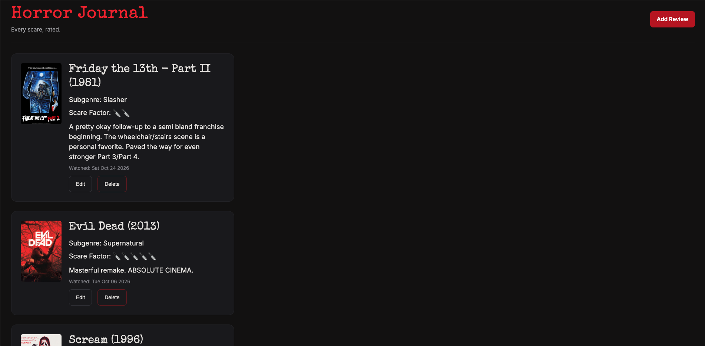
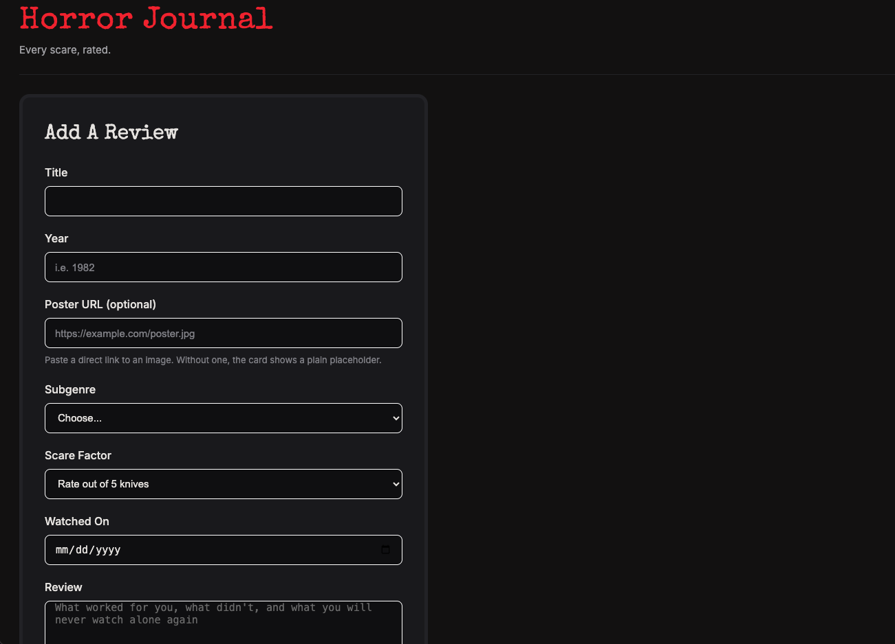

# Horror Journal

Horror Journal is a personal review journal for horror movies. Log the movies you've watched, rate how scary each one was, add a poster and a short review, and edit or delete entries any time.

## Demo




## Try it Here!

[Horror Journal on Render](https://your-app-name.onrender.com)

_Replace this link with your deployed site, or delete this section if the project isn't deployed._

## Features

- Add a review with a title, year, poster image URL, subgenre, scare factor, watched date, and written review
- View every review as a card, with the poster and a knife rating for scare factor
- Edit any review using a form that comes prefilled with the saved details
- Delete a review and see it disappear without needing to reload

## Built with

- Node.js and Express
- MongoDB with Mongoose
- EJS templates
- Plain JavaScript, HTML, and CSS

## Getting started

### Prerequisites

- Node.js and npm
- A MongoDB database and its connection string (a free MongoDB Atlas cluster works)

### Installation

1. Clone the repository and move into the project folder:

   ```
   git clone https://github.com/your-username/horror-journal.git
   cd horror-journal
   ```

2. Install the dependencies:

   ```
   npm install
   ```

3. Create a `.env` file in the project root and add your MongoDB connection string:

   ```
   MONGO_URI=your_mongodb_connection_string
   ```

4. Start the server:

   ```
   node server.js
   ```

5. Open [http://localhost:3000](http://localhost:3000) in your browser.

## Using the app

Click **Add Review** to log a movie. Fill in the form and save, and the review appears at the top of the home page. Use **Edit** on any card to change its details, or **Delete** to remove it.
